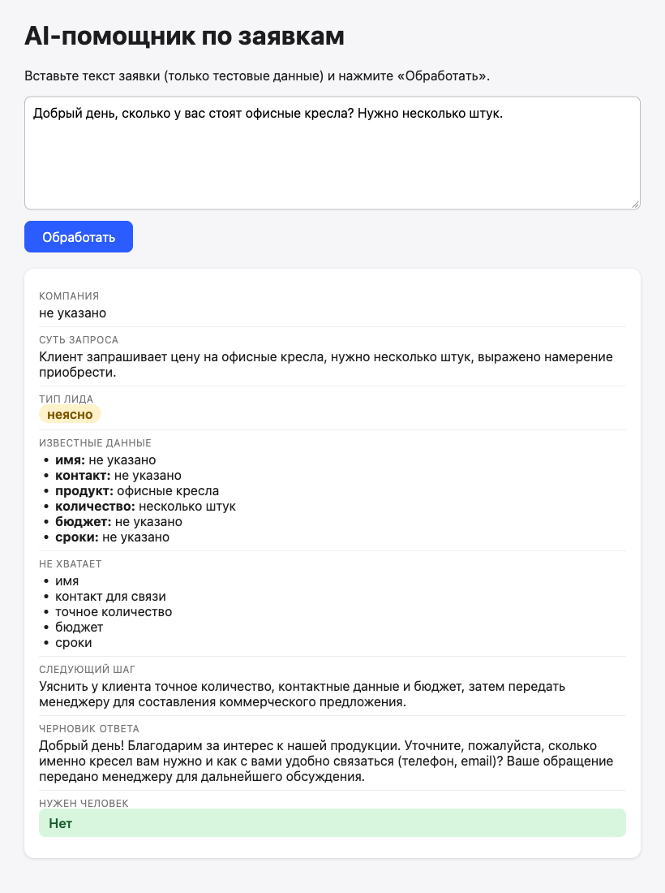

# AI-помощник по заявкам (MVP)

Учебный проект: превращает входящую заявку в карточку для менеджера и передаёт её в CRM Битрикс24.
Все данные в примерах и тестах синтетические (выдуманные имена, телефоны и email).

## Как это работает
1. Менеджер или клиент заполняет форму: имя, телефон или email, текст заявки.
2. **Анонимизация** (`anonymize.js`): телефон, email, ИНН и имя заменяются метками `[ТЕЛЕФОН_1]`, `[EMAIL_1]`, `[ИМЯ_1]`. Имя и контакт из формы нейросеть не получает вообще.
3. Нейросеть по правилам из `system_prompt.md` возвращает карточку: суть, тип лида (целевой, нецелевой, неясно), известные и недостающие данные, следующий шаг, черновик ответа, нужен ли человек.
4. Метки в ответе заменяются обратно на реальные данные.
5. Через входящий вебхук (`bitrix.js`) создаётся лид в Битрикс24 и менеджеру уходит уведомление.
6. Журнал `logs/anonymization_log.csv` хранит только время, тип данных и метку, без самих значений.

## Запуск
Нужен Node.js 20 или новее. Библиотеки ставить не нужно.

1. Скопируйте `.env.example` в `.env`.
2. Вставьте ключ нейросети в `LLM_API_KEY`. По умолчанию используется OpenRouter (бесплатные модели), ключ создаётся на https://openrouter.ai/keys. Подойдёт любой OpenAI-совместимый адрес через `LLM_BASE_URL` и `LLM_MODEL`.
3. По желанию вставьте адрес входящего вебхука Битрикс24 (права `crm`, `task`, `im`) в `B24_URL`. Без него приложение работает, но лид в CRM не создаётся.
4. Запустите `npm start` и откройте http://localhost:3100.

Файл `.env` содержит секреты и не попадает в git. Не публикуйте его и не показывайте адрес вебхука на скриншотах.

## Тесты
`tests/run_protocol.py` прогоняет пять сценариев на запущенном приложении: целевой лид, нецелевой, жалоба, недостаточно данных, анонимизация. В `tests/protokol_prohod1.json` и `protokol_prohod2.json` лежат результаты до и после исправлений, в `docs/korrektirovka.txt` промпты исправлений.

## Ограничения
- Правила квалификации и тон ответа задаются только в `system_prompt.md`, с бесплатными моделями ответы от прогона к прогону могут отличаться.
- Анонимизация находит телефоны, email, ИНН и имя из формы. Другие персональные данные в свободном тексте (адреса, паспортные данные) она не ловит.
- Это MVP: нет авторизации, базы данных и автоматического источника заявок.
